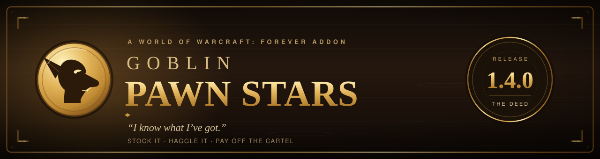
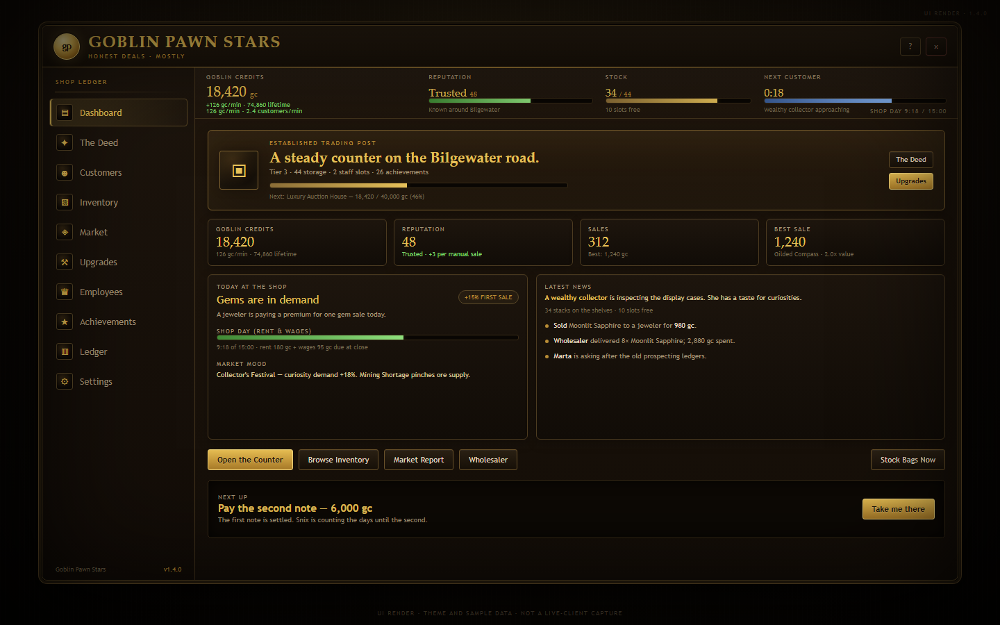
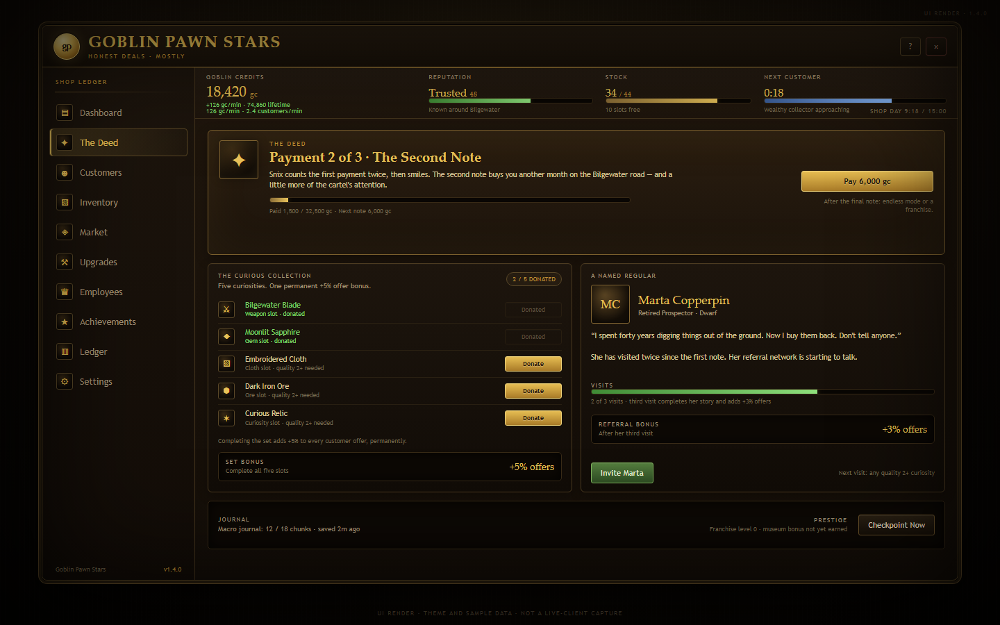
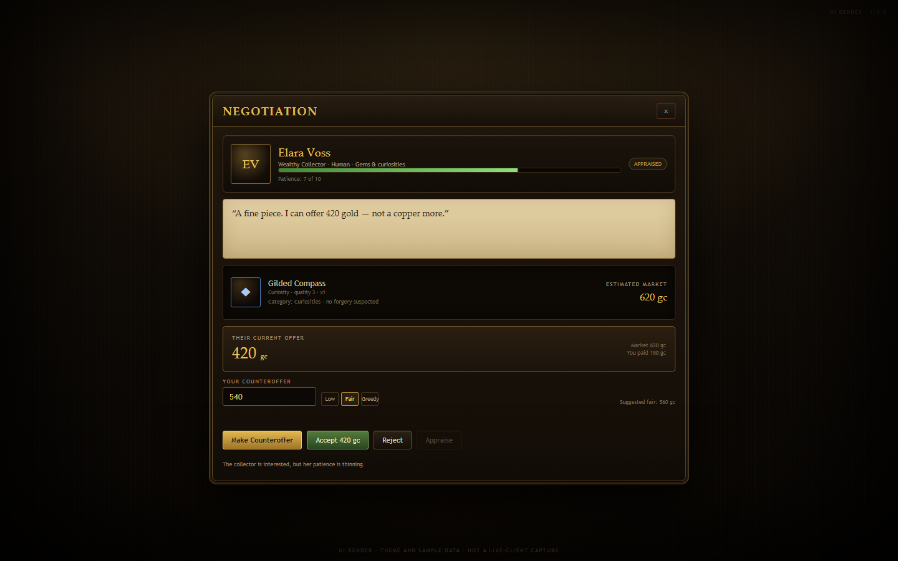
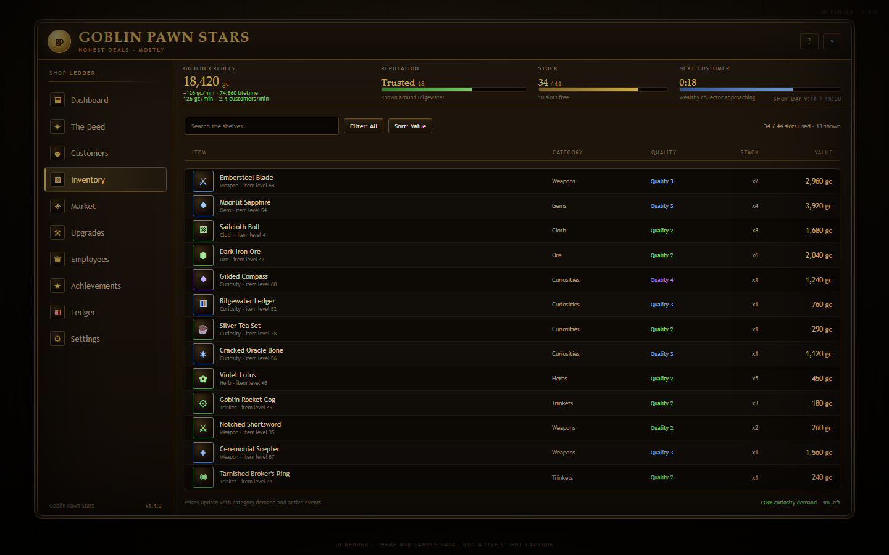
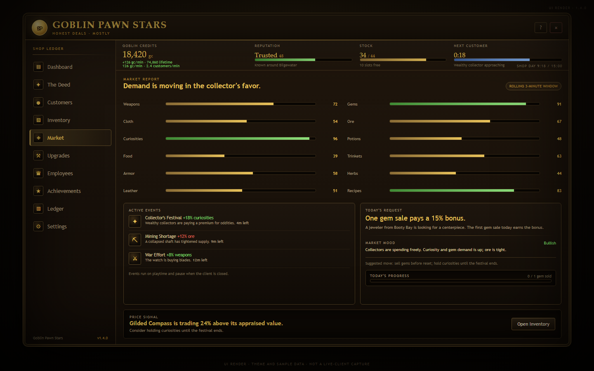
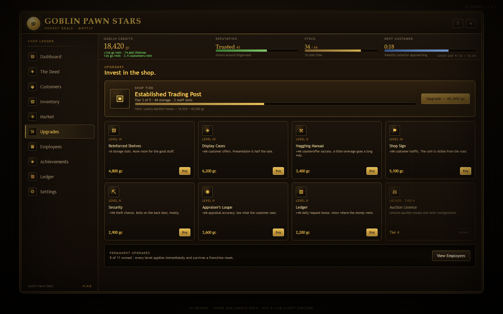
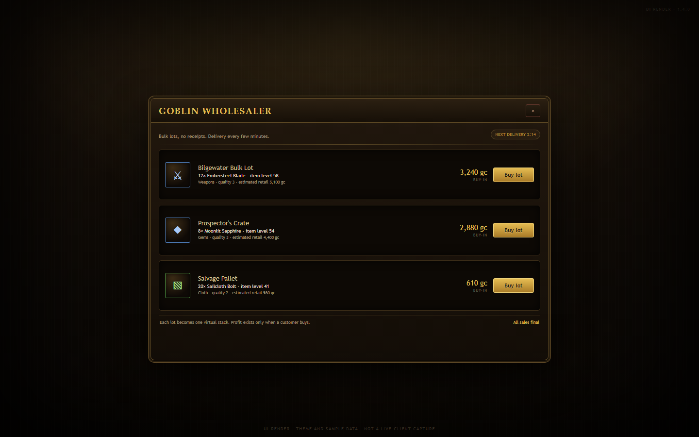
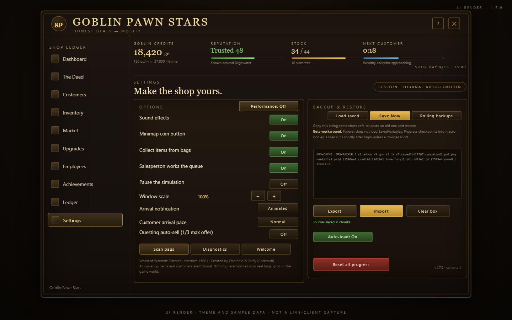

<p align="center">
  
</p>

<p align="center">
  <a href="https://github.com/kidseib/goblin-pawn-stars/actions/workflows/ci.yml"></a>
  
  
  
  
  
  
</p>

<p align="center">
  <strong>Loot it. Stock it. Haggle it. Pay off the cartel.</strong><br>
  A pawnshop management and trading-empire minigame for <strong>World of Warcraft: Forever</strong>.<br>
  Native Lua 5.1 · no libraries · no real gold, items, or game state touched.
</p>

> “I know what I’ve got.” — every customer, eventually.

**Created by ErrorSeib & Buffy (Codebuff).**

<p align="center">
  <a href="#install">Install</a> ·
  <a href="#verify-the-download">Verify download</a> ·
  <a href="#the-loop">The loop</a> ·
  <a href="#screenshots">Screenshots</a> ·
  <a href="#interface">Interface</a> ·
  <a href="#the-deed-140">The Deed</a> ·
  <a href="#persistence-important-beta-note">Persistence</a> ·
  <a href="#compatibility-and-safety">Safety</a> ·
  <a href="#development">Development</a> ·
  <a href="TESTING.md">Testing 1.7.9</a> ·
  <a href="#ai-disclosure">AI disclosure</a> ·
  <a href="#license">License</a>
</p>

> **Status — 1.7.9.** The addon is feature-complete and passes the
> 59-test headless suite plus the UI smoke pass. Live-client validation is still in
> progress: see [TESTING.md](TESTING.md) for the in-game checklist and
> [Testing status](#testing-status) for what is and is not verified.
>
> **1.7.9** brings the saved-shop load back at login with a hard cap of four reads
> and no retry chains, lets **Settings → Auto-load** turn it off, keeps **Settings →
> Backup & Restore → Load saved** as the recovery path, and spreads every macro write
> and delete across ticks so a save can never stall a frame. **1.7.8** added one-click **Performance mode**, arrival-card
> aggregation and rolling `/gps profile` timings. See the
> [release notes](https://github.com/kidseib/goblin-pawn-stars/releases/tag/v1.7.9)
> for the full patch notes.

---

## What it is

Loot items in the world and virtual copies appear on your shelves, or buy bulk lots
from a goblin wholesaler when the shelves run dry. Randomly generated customers wander
in, size up your stock, and make offers based on their personality, budget, taste and
your reputation. Take the money, reject them, or haggle. Hire a salesperson to work the
queue at a lower margin while you are busy, then reinvest in storage, staff, security,
advertising and four bigger shop tiers, ending with an Azeroth Trading Empire.

Everything is simulated inside the addon: Goblin Credits are fictional, the
customers are procedural, and no real item, bag slot or copper is ever touched.

---

## Screenshots

<p align="center">
  <em>UI renders built from the addon's theme, labels and sample state — not live-client captures.</em>
</p>

<p align="center">
  <a href="docs/screenshots/01-dashboard.png"></a>
  <a href="docs/screenshots/02-deed.png"></a>
</p>
<p align="center"><sub><b>Dashboard</b> — credits, reputation, stock and the next customer &nbsp;|&nbsp; <b>The Deed</b> — payments, museum set and Marta</sub></p>

<p align="center">
  <a href="docs/screenshots/03-negotiation.png"></a>
  <a href="docs/screenshots/04-inventory.png"></a>
</p>
<p align="center"><sub><b>Negotiation</b> — offer, counter and patience &nbsp;|&nbsp; <b>Inventory</b> — virtual stock, quality and value</sub></p>

<p align="center">
  <a href="docs/screenshots/05-market.png"></a>
  <a href="docs/screenshots/06-upgrades.png"></a>
</p>
<p align="center"><sub><b>Market</b> — demand, events and today's request &nbsp;|&nbsp; <b>Upgrades</b> — permanent improvements</sub></p>

<p align="center">
  <a href="docs/screenshots/07-wholesaler.png"></a>
  <a href="docs/screenshots/08-settings.png"></a>
</p>
<p align="center"><sub><b>Wholesaler</b> — bulk lots bought with credits &nbsp;|&nbsp; <b>Settings</b> — interface, backup and diagnostics</sub></p>

> **These are UI renders, not live-client screenshots.** They are 1440×900 mockups
> using the addon's theme, labels and sample state, and each image says so. The
> in-game visual pass is still pending; see [TESTING.md](TESTING.md).

---

## Install

1. Download
   [`GoblinPawnStars-1.7.9.zip`](https://github.com/kidseib/goblin-pawn-stars/releases/download/v1.7.9/GoblinPawnStars-1.7.9.zip)
   from the [v1.7.9 release](https://github.com/kidseib/goblin-pawn-stars/releases/tag/v1.7.9),
   or build it with `npm run package`.
2. Extract it so the folder layout is:

   ```
   World of Warcraft/_classic_beta_/Interface/AddOns/GoblinPawnStars/GoblinPawnStars.toc
   ```

3. Restart the client or type `/reload`, then `/gps` to open the shop.
4. A saved shop loads by itself shortly after login (at most four reads, then it
   settles). If you would rather load it by hand, turn **Settings → Auto-load** off
   and use **Settings → Backup & Restore → Load saved** (press it twice). On a fresh
   install the load finds nothing and saving begins from that moment.

The addon declares `## Interface: 16001`, matching the Forever build documented by
[forever-addon-kit](https://github.com/Thunderz96/forever-addon-kit).

---

## Verify the download

Check it before extracting:

```powershell
# Windows PowerShell
Get-FileHash .\GoblinPawnStars-1.7.9.zip -Algorithm SHA256
```

```bash
# macOS / Linux
shasum -a 256 GoblinPawnStars-1.7.9.zip
# or: sha256sum GoblinPawnStars-1.7.9.zip
```

Compare the result with the
[`GoblinPawnStars-1.7.9.zip.sha256`](https://github.com/kidseib/goblin-pawn-stars/releases/download/v1.7.9/GoblinPawnStars-1.7.9.zip.sha256)
attached to the same release. The published `GoblinPawnStars-1.7.9.zip` is
3,336,136 bytes with SHA-256
`c116e68c371e6c6e1e221d02b69bbebc097e47ed3b3bd7a8aad8891e7bc2b006`.

---

## The loop

1. **Stock** — new eligible loot becomes virtual stock, or buy a bulk lot from the
   **Wholesaler** (`/gps wholesale`). The first bag scan is a silent baseline, so
   installing the addon never dumps your existing bags into the shop.
2. **Appraise** — the market tab shows category demand; the shop dashboard shows
   today's request. Item values come from rarity, item level, category and live demand.
3. **Haggle** — a customer arrives with a hidden ceiling. Accept, reject, or counter.
   Counters are probabilistic: personality stubbornness, reputation and your appraisal
   bonus shift the odds, and patience runs out.
4. **Automate** — hire the salesperson and she works the waiting queue on a timer,
   selling at a discount to market value. Toggle her off in Settings if you want every
   sale to be your own.
5. **Invest** — storage, display cases, haggling manuals, security, accountants,
   marketers, appraisers, salespeople and treasure hunters. Then upgrade the shop.
6. **Watch the rates** — the header and dashboard show **credits per minute** and
   **customers per minute** over a rolling three-minute window, so every upgrade and
   every stock purchase changes a number you can see.
7. **Pay the deed** — the cartel has a three-note debt of 1,500 / 6,000 / 25,000 gc.
   The first payment unlocks **The Curious Collection** museum and **Marta Copperpin**,
   a named regular with three story visits. The third payment closes the ledger and
   offers a choice: keep the shop open in endless mode, or open a franchise with a
   permanent offer bonus.
8. **Repeat** — rent and wages are charged every shop day (15 minutes of play).
   Expenses are real; a shop that does not trade slowly starves.

This is an incremental loop, not an offline game: the shop only trades while the
client is running and the simulation is not paused. There are deliberately no offline
earnings, because every credit must come from a virtual item a customer actually
bought.

### If loot is not appearing

The first bag scan is a silent baseline, so existing loot is not dumped into stock
without asking. Click **Stock Bags Now** on the Dashboard (or type `/gps importbags`)
to copy eligible items you are already carrying. After that, new pickups stock
themselves. `/gps scan` prints exactly what the bag reader sees: readable containers,
stack and item counts, and how many stacks are eligible, skipped (grey/quest/key) or
still uncached.

---

## Interface

A dark-wood-and-gold trading post, built from Blizzard's own dialog, tooltip and icon
textures. A first-run **splash screen** explains the loop in three steps; after an
update it becomes a **what's new** screen. Both can launch a seven-step **guided tour**
that spotlights the header, tabs, haggling, upgrades and the campaign, and both credit
the authors.
Reopen the splash with `/gps welcome`, replay the tour with `/gps guide`. Modern client
integration includes a **Blizzard Settings category** (Game Menu → Options → AddOns) and
an **Addon Compartment** entry, alongside the draggable coin.

The dashboard also has a **Next Up** card that always points at the most useful next
action: take the tour, stock the shelves, meet a customer, make a sale, buy a wholesale
lot, buy an upgrade, reach tier 2, hire your first employee, serve ten customers, then
pay the three cartel notes, donate to the museum and serve Marta.
Windows, tabs, popups and toasts
fade in, the credits counter pops when it changes, and the selected tab pulses — all
with instant fallbacks if a client lacks the animation API.

Ten tabs plus a movable negotiation window, a standalone wholesaler window and event popups:

| Tab | What lives there |
| --- | --- |
| **Dashboard** | Shop tier and progress, credits, reputation, sales, best sale, credits/min, customers/min, today's request, shop-day timer, market mood, latest stock, last visitor and the Wholesaler shortcut |
| **The Deed** | Three cartel payments, the Curious Collection museum set, Marta Copperpin, endless mode, the ending and the franchise reset, plus journal status |
| **Customers** | Who is at the counter, the waiting queue with patience, today's request, active encounter, last visitor |
| **Inventory** | Searchable, filterable, sortable virtual stock with real item tooltips, stack counts and live market values |
| **Market** | Demand index for all twelve categories, active events with countdowns |
| **Upgrades** | Shop tier upgrades and eleven permanent upgrades with levels and costs |
| **Employees** | Six staff, hiring, promotion, wages and the salesperson's queue automation |
| **Achievements** | 26 custom milestones with progress bars and fictional shop titles |
| **Ledger** | Filterable transaction history and lifetime totals |
| **Settings** | Performance mode, sound, minimap button, auto-collect, questing auto-sell, arrival pace, pause, window scale, **Load saved**, backup/restore, rolling backups, diagnostics, reset |

A standalone **Wholesaler** window (Dashboard → Wholesaler, or `/gps wholesale`) sells
three rotating bulk lots for Goblin Credits. Each lot is one virtual stack; the price is
a discount to live, stack-adjusted market value, so a crash after purchase is a real
loss. All lots refresh every four minutes, or sooner after the last one is bought.

Also included: a draggable minimap coin with live tooltip and a waiting-customer
alert, toasts, optional sound cues, and item tooltips throughout.

### Commands

```
/gps, /goblinpawnstars   open or close the shop
/gps test                run the built-in simulation diagnostics
/gps debug               toggle debug output
/gps backup              jump to Settings > Backup & Restore
/gps welcome             show the splash (first-run or what's new)
/gps guide               replay the guided tour
/gps scan                report bag containers, stacks and eligibility
/gps importbags          stock eligible items already in your bags
/gps wholesale           open the wholesaler's bulk stock
/gps options             open the Blizzard AddOn options category
/gps reset               wipe all progress (asks twice)
/gps journal             whether progress is saving, chunk count and last error
/gps report              pasteable client, save, error and economy report
/gps profile             time the backup, stock sort, bag scan and UI refresh
/gps verify              save, read the save back and compare it with this run
/gps uicheck             report any window that sits off-screen at this scale
/gps motion              turn window animations and flourishes on or off
/gps version             version, interface number and authors
/gps help                command list
```

---

## System detail

### Customers

Nine archetypes: cheap bargain hunter, wealthy collector, experienced trader, gullible
adventurer, desperate buyer, suspicious goblin, impatient warrior, traveling merchant
and mysterious rare-item collector. Each has its own opening-offer range, hidden
ceiling, budget, patience, stubbornness, preferred categories and dialogue.

Rare collectors and celebrity visitors appear with tier, upgrades and staff bonuses.
Customers occasionally arrive as events: a returning complainer, a lowball artist, a
counterfeit seller or a hooded figure with very specific taste.

### Negotiation

```
marketValue   = baseValue × category demand × events
hiddenCeiling = min(marketValue × personality will × reputation ×
                    rarity × random, customer budget, marketValue × 2.8)
openingOffer  = hiddenCeiling × personality opening range
```

The negotiation window prints the exact chance of the price you type, and that
percentage is the number the acceptance roll uses. Customers open below their hidden
ceiling, so a counter above their offer still has margin to earn.

A counter below the ceiling is accepted probabilistically, driven by how much margin
you left, the customer's stubbornness, your haggling upgrades, appraisal bonus and
reputation. A counter above the ceiling makes them push back once, then leave. Absurd
demands end the conversation immediately. Appraisal (unlocked at tier 2 or with an
appraiser) reveals value within an accuracy band; a perfect read also hints at what
the customer can actually pay.

### Economy

* **Goblin Credits** — the only currency. Nothing is ever converted to or from gold.
* **Market events** — 11 demand shocks including War Effort, Alchemist Convention,
  Mining Shortage, Goblin Market Crash, Collector's Festival and Auction Frenzy.
  They run on playtime, so logging out pauses them.
* **Shop days** — every 15 minutes of play, rent and wages are charged. The
  salesperson is separate: while hired, she closes queued sales on a timer (12 seconds
  at level 1, down to 6 seconds at level 5) at 76–94% of live market value.
* **Daily request** — one category pays a bonus on the first matching sale of the day.
* **Wholesaler** — bulk lots cost credits up front and become virtual stock. The
  purchase price is 30–34% of live stack-adjusted retail value at tier 1–5; auto-sales
  pay less than haggling, so idle profit is real but thinner.
* **Throughput** — credits/min and customers/min are computed from completed sales in
  a rolling 180-second window (`Modules/Throughput.lua`). No timer writes credits.
* **Anti-exploit design** — every sale consumes a virtual item; prices are capped at
  2.8× market value (2.6× on base value); counters are probabilistic rather than
  guaranteed; stock is capacity-limited; loot detection is a bag diff, not an event
  trigger, so repeated events cannot duplicate inventory; and the shop never creates
  credits without a corresponding sale, event reward or auction result.

### The Deed (1.4.0)

A three-payment cartel debt gives the shop a finish line and a reason to reinvest:

1. **The First Note — 1,500 gc.** Unlocks The Curious Collection and Marta Copperpin.
2. **The Second Note — 6,000 gc.** Snix starts taking the shop seriously.
3. **The Final Note — 25,000 gc.** The ledger closes and the ending card appears.

After the debt, choose **endless mode** (keep playing the same shop) or **open a
franchise** (reset credits, stock, tier, upgrades and staff, keep the museum, Marta,
achievements and every permanent offer bonus, and add +5% offers per franchise level).

The **Curious Collection** has five slots — weapon, gem, cloth, ore and curiosity.
Each donation consumes one non-counterfeit quality-2+ virtual stock unit; completing
the set adds a permanent +5% to customer offers. **Marta Copperpin** is a named Dwarf
regular with three story visits. Each visit is a normal sale that consumes stock; after
the third, her referral network adds a permanent +3%. Both are preserved by prestige.

### Progression

1. Roadside Trading Stall — 12 storage, no staff, about 20s between customers, two waiting slots
2. Goblin Pawnshop — 24 storage, 1 staff slot
3. Established Trading Post — 44 storage, 2 staff slots
4. Luxury Auction House — 72 storage, 4 staff slots
5. Azeroth Trading Empire — 120 storage, 6 staff slots

Each tier brings wealthier customers, faster traffic, better appraisal, more rare
visitors and reputation bonuses. Eleven upgrades (shelves, cases, haggling manual,
sign, security, ledger, lounge, loupe, plaques, auction licence, blimp) add levels on
top.

### Achievements

26 milestones including the requested *Best I Can Do* (100 sales), *Highway Robbery*
(sell at 2× value), *Absolutely Not* (100 rejections), *Goblin Millionaire* (1,000,000
lifetime credits), *Professional Lowballer* (50 won counters), *I Know What I've Got*
(sale to a rare collector), *Let Me Call an Expert* (100 appraisals), *Curator of
Curiosities*, *A Regular's Regular* and *Free Goblin*. Unlocks award fictional shop
titles shown in the Achievements tab.

---

## Persistence (important beta note)

The addon uses standard `## SavedVariables: GoblinPawnStarsDB`, saves on logout, and
autosaves every 5 minutes of play while the shop window is closed and no customer is
at the counter.

**Known client issue:** on the current Forever beta, the client writes SavedVariables
on exit but does not load them back at login (documented by forever-addon-kit, and
independent of any addon). Blizzard may fix this. Until then, the addon has two paths:

* **Macro journal, loaded automatically but bounded** — progress is checkpointed into
  alternating macro generations (`GPSA01`–`GPSA12` and `GPSB01`–`GPSB12`, the same
  24-macro footprint; small shops need two or three per save). Each chunk is a short
  comment header plus base64 data and a checksum. Login arms one short load: at most
  four reads of the macro list, two to thirty seconds apart, one attempt counter and no
  chained retries, and the last attempt always settles. While it runs the header reads
  `loading saved shop` and every save is refused, so a fresh session can never stamp
  defaults over a run it has not read. **Settings → Auto-load** turns the login load
  off, and **Settings → Backup & Restore → Load saved** (press it twice) repeats one
  read on demand. `/gps journal` reports which path loaded the run.
  Each save is a queue of single macro operations with an 8 ms budget per tick, so a
  save writes one chunk per frame instead of the whole generation at once. Every
  chunk is read back and compared as it is written, and a generation only becomes
  current when its header is rewritten as committed at the end, so an interrupted or
  rejected save always leaves the previous run intact. Cleanup of the retired
  generation happens after the commit, one macro per step. **Save Now**, logout,
  import and `/gps verify` finish a staged save immediately. The snapshot keeps the
  shop, campaign, museum, Marta, prestige, settings and achievements, drops every
  value that still matches its default, packs stock as compact tuples, and
  deliberately omits the 250-entry ledger and the live customer queue. If the compact
  snapshot is still too large, the lowest-value stock is trimmed first; campaign
  state is never trimmed. Macro bodies survive a cold client restart because they are
  server-side. The Deed tab shows journal status and a **Checkpoint Now** button. If
  macro slots are full, the UI reports it.
* **Manual backup string** — **Settings → Backup & Restore → Export** generates a
  full, self-contained save string (no `loadstring`, custom codec). Paste it back and
  hit **Import** to restore everything, including history. This remains the
  belt-and-braces option and the only one that preserves the full ledger.

No offline time is simulated. The journal restores whatever you load, whenever you
load it; it does not simulate sales, arrivals or earnings while the client was closed.
The code also works unchanged if/when the client restores SavedVariables normally; a
newer SavedVariables snapshot wins over an older macro journal, and a normal
SavedVariables load still needs no button.

---

## Compatibility and safety

* **Client:** Forever, Interface 16001, Retail-derived. Classic globals such as
  `GetItemInfo`, `GetContainerItemID` and `UnitAura` are gone; everything uses the
  `C_*` namespaces through one guarded compatibility layer.
* **No protected or secure APIs**, no combat-log reading, no secret values, no
  automation, no hardware events, no taint-prone state drivers.
* **Nothing real is modified:** bags are only read (never written), no items are
  equipped, sold, destroyed or mailed, no gold or currency is spent, and no game
  actions are triggered.
* Every risky call (`C_Item`, `C_Container`, event registration, `SOUNDKIT`,
  `C_Timer`, backdrops, fonts) is `pcall`-wrapped or feature-checked, so a missing API
  degrades gracefully instead of aborting the file.

---

## Development

```
addon/GoblinPawnStars/
  GoblinPawnStars.toc
  Core/        Bootstrap, Compatibility, Persistence, Journal, Slash
  Data/        Items, Names, Personalities, Upgrades, Employees, Wholesale,
               MarketEvents, Encounters, Achievements, Deed
  Modules/     Clock, Market, Inventory, Loot, Shop, Wholesaler, Staff, Customers,
               Negotiation, Encounters, Achievements, History, Throughput, Goals,
               Museum, Regular, Campaign, Sound, Diagnostics
  UI/          Theme, Widgets, Anim, MainFrame, Tour, WelcomeFrame, OptionsPanel,
               MinimapButton, NegotiationFrame, EventFrame, WholesalerFrame
  UI/Tabs/     Dashboard, Deed, Customers, Inventory, Market, Upgrades, Employees,
               Achievements, History, Settings
tools/         Lua 5.1 syntax check, headless harness, WoW mock, UI smoke, packager
```

Requirements: Node 18+ for tooling only. The addon itself has no dependencies.

```bash
npm install          # luaparse + fengari, dev only
npm run check        # Lua 5.1 syntax over every source file
npm test             # runs the simulation diagnostics + UI smoke in fengari
npm run verify       # both of the above
npm run package      # builds dist/GoblinPawnStars-<version>.zip
node tools/sim_30min.js  # optional: 30-minute progression probe + 10-minute idle probe
```

The headless harness loads all 61 addon files in TOC order with mocked WoW APIs,
runs the 59-test diagnostics suite (economy, negotiation invariants, wholesaler, salesperson auto-sales,
throughput, encounters, serialization, achievements, expenses, macro-journal
round-trip/corruption/immediate rebind/deferred franchise commits, the three payments,
museum donations, Marta and franchise),
then builds every tab
and overlay, opens the wholesaler, checks first-run vs update splash modes, walks every
guided-tour step, advances the Next Up goals, and verifies the bag path: empty-slot
safety, first loot after an empty baseline, re-looting after bags empty, uncached items
resolved from hyperlinks, one-shot import without duplication, and scan deduplication.
It also checks Settings/Compartment registration and simulates a full hour of gameplay
ticks. See `PROGRESS.md` for exactly what was and was not verified.

`AGENTS.md` documents conventions and invariants for future contributors.

---

## Testing status

* Lua 5.1 syntax check: **passing** (61 files, 17,498 lines).
* Headless diagnostics suite: **59/59 passing** (the exact count is printed by
  `npm test`).
* UI smoke (all tabs, splash modes, guided tour, goal card, options panel, negotiation,
  events, wholesaler window, slash commands) and a simulated hour of play: **passing
  under mocks**.
* 30-minute progression probe (a fixed scripted policy that never pays the cartel
  debt): 40 sales and 2,472 gc earned, tier 2 reached at minute 25, 449 gc left and
  1.0–1.3 customers/min. A 10-minute closed-window probe records 17 auto-sales, an
  empty queue and 193 gc/min. These are simulation numbers, not a live-client feel
  test.
* **Not yet verified in the live client:** real item tooltips, texture appearance,
  font sizes and layout on different UI scales, the Deed tab and its five museum rows,
  macro creation/edit permissions, the bounded login load and the Settings load
  button on a real macro list, and a staged save on a full stockroom,
  whether Marta appears at a sensible cadence, whether the payment amounts fit a real
  play session, the Wholesaler window and rate header, actual bag-based loot capture,
  SavedVariables behaviour once Blizzard fixes loading, and sound cue availability.
  See [TESTING.md](TESTING.md) for the in-game checklist.

No code in this repository has been executed inside World of Warcraft.

---

## AI disclosure

Goblin Pawn Stars is **human-directed and AI-assisted**. **ErrorSeib** sets the
requirements, reviews changes and approves releases; **Buffy (Codebuff)**, an AI
coding agent, helped write the addon code, tests, documentation and release tooling.
The addon uses no AI at runtime, makes no network requests, and collects no player
data. Read the full [AI disclosure](AI-DISCLOSURE.md).

---

## License

Goblin Pawn Stars is released under the [MIT License](LICENSE).

You may use, copy, modify, merge, publish, distribute, sublicense, and sell copies
of the addon, provided the copyright notice and this permission notice are included.
The addon is provided **"as is"**, without warranty of any kind.

World of Warcraft and related marks are trademarks of Blizzard Entertainment. This
is an unofficial fan project, not affiliated with or endorsed by Blizzard. Blizzard's
add-on policy independently requires addons to be distributed free of charge; the
MIT License does not change that policy.
