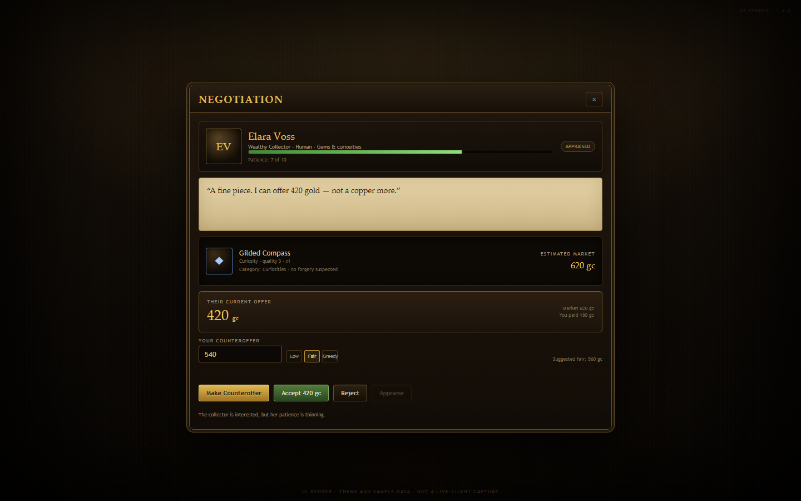
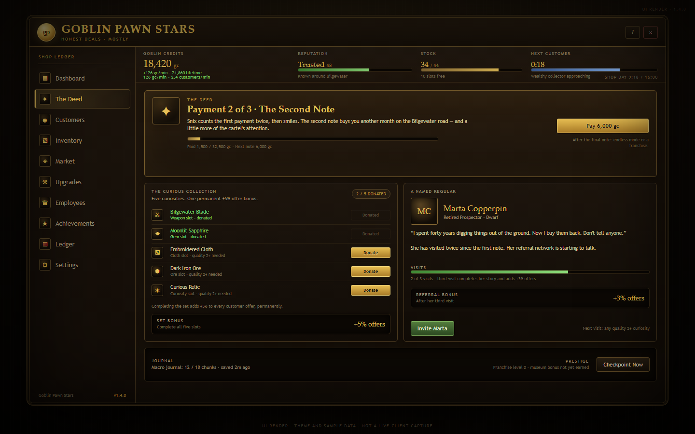

# Goblin Pawn Stars

**Run a goblin pawnshop in World of Warcraft: Forever.** Stock the junk you loot, haggle with customers who all have hidden budgets, read a market that moves under you, and pay off a three-note cartel debt. No real gold, no real items, no automation of the game client.

## What it is

Goblin Pawn Stars turns the loot you already find into a shop with a big problem: a cartel debt, a growing museum, and a queue of customers who think they can smell desperation. Stock the shelves, appraise the goods, haggle like you've got a knife in your boot, and grow a 12-slot roadside stall into a 120-slot trading empire.

Every credit comes from a virtual item a customer actually bought. There are no offline earnings, no real gold, and your bags are only ever read, never changed.

## What's new in 1.6

- **Questing auto-sell.** A Settings toggle serves the queue while the shop window is closed, even with no salesperson hired. It pays a third of the best manual deal and is off by default.
- **Customers walk in.** Native WoW NPC models in the portrait and arrival cards, with an icon fallback if the model is missing.
- **Arrival pace you control.** Fast, Normal and Relaxed presets, plus `/gps arrival`. The header tells you what is holding a customer up.
- **Minimap coin fixed.** The ring sits around the coin again, and the waiting-customer alert is a small gold pip instead of a green square.

## How it plays

1. **Stock the shelves.** Eligible loot you pick up becomes virtual stock. The first scan is a silent baseline, so installing never dumps your existing bags into the shop; use **Stock Bags Now** or `/gps importbags` if you want them in.
2. **Read the room.** Twelve categories run their own demand curves, and eleven market events bend them, from a Mining Shortage to a Goblin Market Crash.
3. **Haggle.** Every customer has a budget, a taste, a hidden ceiling and a patience bar. Accept, refuse or counter — push too hard and they walk.
4. **Reinvest.** Storage, display cases, haggling manuals, security, staff and four bigger shop tiers. A salesperson works the queue while you're busy, at a thinner margin.
5. **Pay the deed.** Three notes: 1,500, then 6,000, then 25,000 Goblin Credits. Then endless mode, or open a franchise.

## What's in it

- Five shop tiers, eleven permanent upgrades, six employees and 26 achievements.
- Nine customer archetypes with hidden ceilings, plus rare collectors, celebrity visits and event customers.
- The Curious Collection: five museum slots that permanently raise customer offers when the set is complete.
- Marta Copperpin, a named regular with three story visits and a referral bonus.
- Ten tabs: dashboard, Deed, customers, inventory, market, upgrades, employees, achievements, ledger and settings.
- A first-run splash, a seven-step guided tour (`/gps guide`), item tooltips, a draggable minimap coin and an optional sound pass.

## Safe by design

- Bags are read, never written. No equip, sell, destroy, trade or mail.
- No real gold, items, auctions or game actions. Goblin Credits are fictional.
- No protected APIs, no combat-log parsing, no automation of gameplay.
- No libraries, no external services, no network calls, no telemetry.
- Lua 5.1, Interface 16001. Risky client calls are guarded or feature-checked.

**Beta persistence:** on the current Forever beta, SavedVariables may not load at login. The addon checkpoints into an automatic macro journal and also supports a full backup/restore string in Settings. The Deed tab shows journal status and a **Checkpoint Now** button.

## Install

1. Download the ZIP from the **Files** tab.
2. Extract the **GoblinPawnStars** folder into `World of Warcraft/_classic_beta_/Interface/AddOns/`.
3. Restart the client or type `/reload`, then `/gps`.

Useful commands: `/gps` open the shop · `/gps wholesale` the wholesaler · `/gps guide` replay the tour · `/gps welcome` show the splash · `/gps importbags` stock what's already in your bags · `/gps scan` show what the bag reader sees · `/gps backup` backup and restore · `/gps reset` wipe progress (asks twice).

## Verify the download

SHA-256 for **GoblinPawnStars-1.6.1.zip** (3,001,503 bytes):

`2ebea4b24d8b12d450835e6398c48daa13a144ad8fa0156e340646c3bbcfed93`

The 1.4.0 build has a clean VirusTotal report; the 1.6.1 scan is still pending. Compare the hash with the [1.6.1 release notes](https://github.com/kidseib/goblin-pawn-stars/releases/tag/v1.6.1), or read the source — it's plain Lua.

## Status

Feature-complete, with a 30-test headless suite and a UI smoke pass behind it. The live-client visual and persistence pass is still in progress. Interface **16001** (World of Warcraft: Forever).

The screenshots on this page are UI renders of the addon's theme and sample state, not live-client captures. They are labelled as renders and will be replaced with real captures once the in-game pass is finished.

## Credits

Created by **ErrorSeib & Buffy (Codebuff)**. Human-directed, AI-assisted development. No runtime AI, no network requests, no player data. MIT licensed.

Source, changelog and issue tracker: [github.com/kidseib/goblin-pawn-stars](https://github.com/kidseib/goblin-pawn-stars)

Unofficial fan project. Not affiliated with or endorsed by Blizzard Entertainment. World of Warcraft and related marks are trademarks of Blizzard Entertainment.
