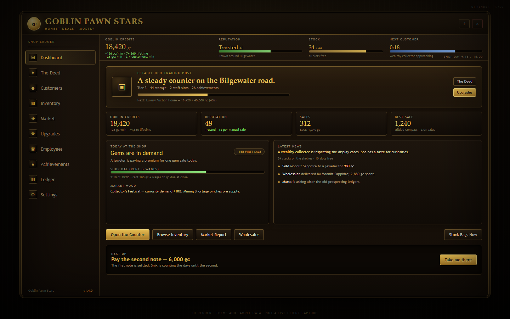
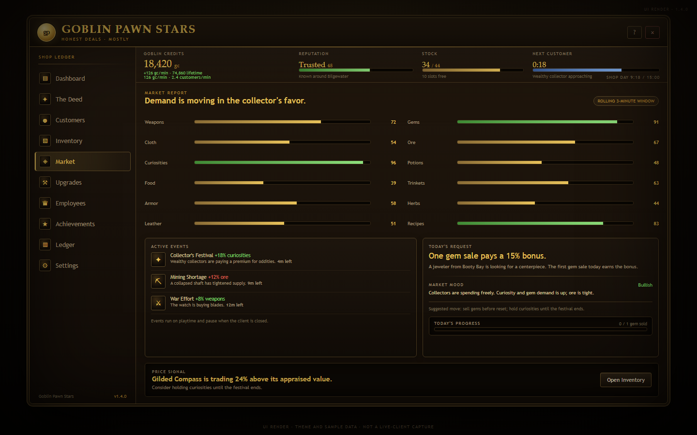
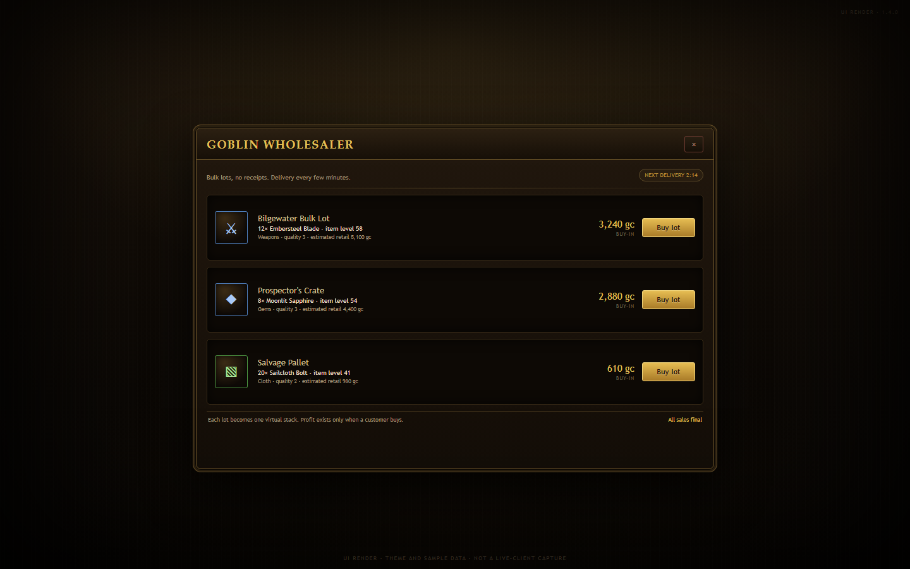
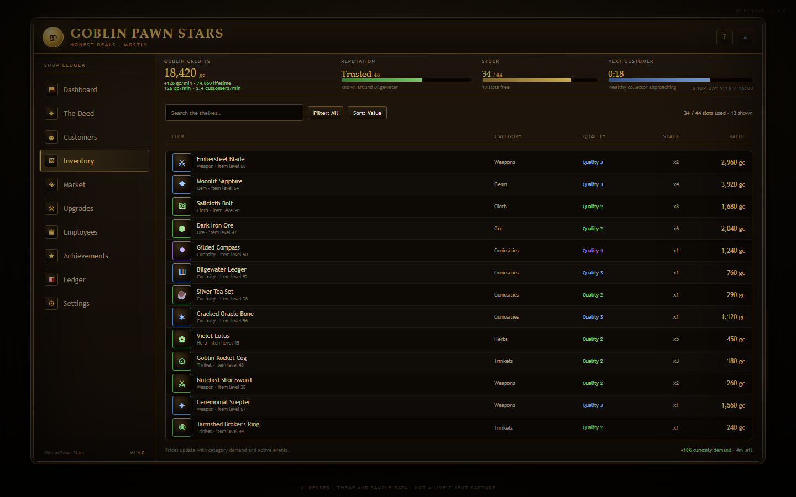
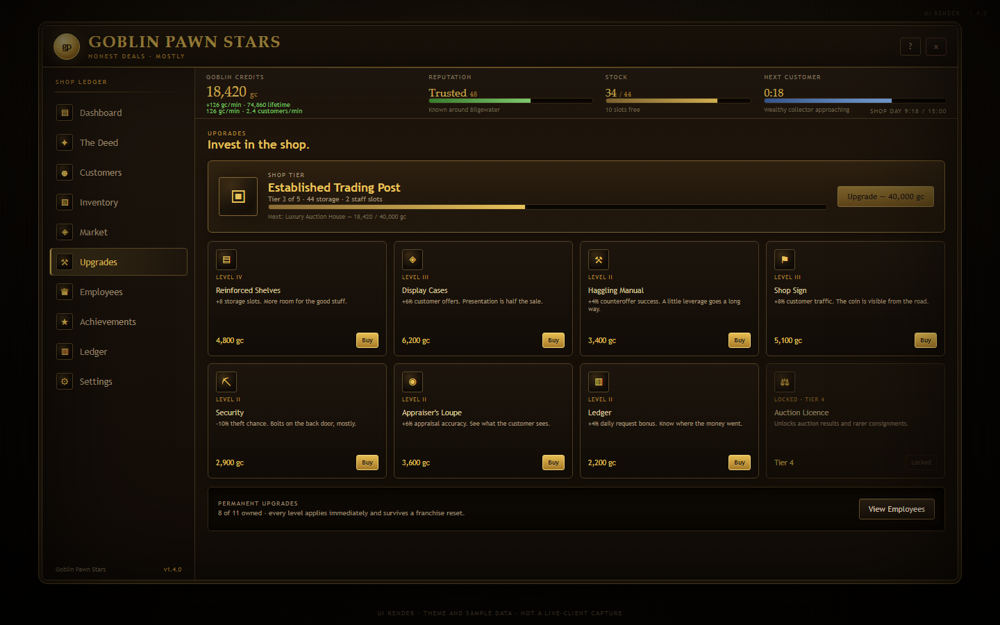
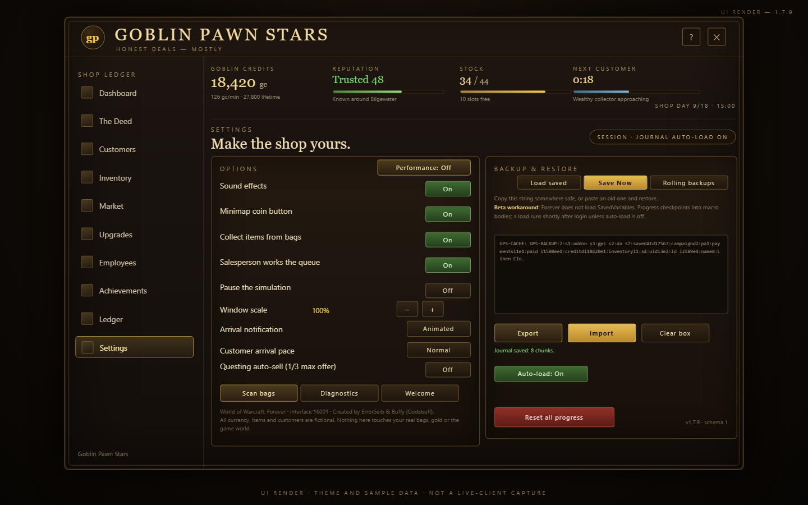

# GOBLIN PAWN STARS

**Loot it. Stock it. Haggle it. Pay off the cartel.**

*A pawnshop management and trading-empire minigame for World of Warcraft: Forever.*

*The screenshots below are UI renders of the addon's theme and sample state, not live-client captures. The in-game visual pass is still in progress.*

*UI render — the Dashboard: credits, reputation, stock, the waiting customer and the next move.*

Your bags are full of junk. To a goblin, that's not junk — that's **inventory**.

Goblin Pawn Stars turns the loot you already find into a shop with a big problem: a cartel debt, a growing museum, and a queue of customers who all think they can smell desperation. Stock the shelves, read the market, haggle like you've got a knife in your boot, and turn a roadside stall into an Azeroth Trading Empire.

**No real gold. No real items. No auctions. No automation of the game client.** Just goblin math.

> "I know what I've got." — every customer, eventually.

---

## WHAT'S NEW IN 1.6

- **Questing auto-sell.** A Settings toggle that serves the queue while the shop window is closed, with no salesperson hired. It waits for combat to end, leaves active negotiations alone, and pays one-third of the best possible manual deal (minimum 1 credit). Off by default.
- **Customers walk in.** Native WoW NPC models in the portrait and arrival cards, with an icon fallback. Drag the arrival card to move it; the open and closed shop remember separate positions.
- **Arrival pace you control.** Fast, Normal and Relaxed presets in Settings, plus **/gps arrival**. Due arrivals wait for stock, a free queue slot or the end of combat, and the header says what is blocking them. The presets now wait twice as long as they did in 1.4.
- **Minimap coin fixed.** The ring sits around the coin again, the button has its round background, and the waiting-customer alert is a small gold pip instead of a green square.

---

## WHAT YOU'RE SIGNING UP FOR

- **A shop that grows** from a 12-slot roadside stall to a 120-slot Azeroth Trading Empire.
- **Customers with secrets.** Nine archetypes, hidden ceilings, and a patience bar that does not care about your plans.
- **A market that bites back.** Twelve categories and eleven demand shocks, including a Goblin Market Crash.
- **A finish line.** Three cartel notes, a museum set, a named regular, and an ending — then endless mode or a franchise.
- **A clean conscience.** No real gold, items, auctions, trades or game actions. Your bags are read, not written.

**9** customer archetypes · **12** market categories · **5** shop tiers · **11** upgrades · **6** employees · **26** achievements.

---

## THE LOOP

**Loot → Stock → Appraise → Haggle → Invest → Repeat.**

1. **Stock the shelves.** Eligible loot you pick up becomes virtual stock. The first scan is a silent baseline, so installing the addon never dumps your existing bags into the shop. Need a top-up? Buy a bulk lot from the Wholesaler.
2. **Read the room.** Twelve categories move on their own demand curves. Events like the Collector's Festival, Mining Shortage and Goblin Market Crash can turn a shelf-warmer into a bidding war.
3. **Haggle.** Every customer has a budget, a taste, a hidden ceiling and a patience bar. Accept the offer, reject it, or counter. Push too hard and they walk.
4. **Reinvest.** Storage, display cases, haggling manuals, security, staff, advertising — then four bigger shop tiers. Hire a salesperson to work the queue while you're busy, at a thinner margin.
5. **Pay the deed.** The cartel wants three notes: 1,500, 6,000 and 25,000 Goblin Credits. Pay up, or find out what a goblin collection agency looks like.

---

## EVERY CUSTOMER HAS A NUMBER

Nine customer archetypes walk through the door: the wealthy collector who knows exactly what the piece is worth, the bargain hunter who opens so low it's almost a threat, the experienced trader who can smell a fake at ten paces, the rare hunter who will pay stupid money for one very specific thing — and five more.

They all have hidden ceilings. Your counter succeeds on a roll shaped by margin, stubbornness, haggling upgrades, appraisal and reputation. Appraise first to see the value band; a perfect read hints at what they can really pay. Patience runs out. So does yours.

*UI render — the negotiation window: offer, counter, appraisal and a patience bar that is already judging you.*

Rare collectors and celebrity visitors appear with tier, upgrade and staff bonuses. Customers occasionally arrive as events: a returning complainer, a lowball artist, a counterfeit seller or a hooded figure with very specific taste.

---

## THREE NOTES. ONE WAY OUT.

The cartel debt gives the shop a finish line: **1,500 → 6,000 → 25,000 Goblin Credits**. The first payment unlocks The Curious Collection and Marta Copperpin. The third closes the ledger and offers a choice: keep the shop open in endless mode, or open a franchise.

The **Curious Collection** has five slots: weapon, gem, cloth, ore and curiosity. Each donation consumes a quality-2+ virtual stock unit; completing the set adds a permanent **+5% to customer offers**. **Marta Copperpin** is a named Dwarf regular with three story visits. After her third, her referral network adds a permanent **+3%**.

*UI render — the Deed: three payments, five museum slots, Marta's visits and the ending choice.*

---

## READ THE MARKET. BUY THE DIP.

Demand moves. Twelve categories have their own curves, and eleven market events can bend them: War Effort, Alchemist Convention, Mining Shortage, Goblin Market Crash, Collector's Festival, Auction Frenzy and more. Events run on playtime, so logging out pauses them.

The **Wholesaler** sells three rotating bulk lots for Goblin Credits. Each lot becomes one virtual stack; the price is a discount to live, stack-adjusted market value. A crash after purchase is a real loss. Lots refresh every four minutes, or sooner after the last one is bought.

*UI render — the Market: twelve demand bars, active events and today's request.*

*UI render — the Wholesaler: three bulk lots, live margins and a four-minute refresh.*

There are no offline earnings. Every credit must come from a virtual item a customer actually bought.

---

## A SHOP, NOT A BUTTON.

Ten tabs cover the dashboard, Deed, customers, inventory, market, upgrades, employees, achievements, ledger and settings. Five shop tiers, eleven permanent upgrades, six employees and 26 achievements give every run a new lever to pull.

*UI render — Inventory: searchable, filterable virtual stock with real item tooltips and live values.*

A first-run **splash screen** explains the loop in three steps. After an update it becomes a **what's new** screen. Both can launch a seven-step **guided tour** that spotlights the header, tabs, haggling, upgrades and the campaign. Reopen the splash with **/gps welcome**; replay the tour with **/gps guide**.

*UI render — Upgrades: shop tiers, eleven permanent improvements and the next thing to buy.*

Also included: a draggable minimap coin with a waiting-customer alert, toasts, optional sound cues, item tooltips, a Blizzard Settings category and an Addon Compartment entry.

---

## SAFE BY DESIGN.

- **Bags are read, never written.** No equip, sell, destroy or mail.
- **No real gold, items, auctions, trades or game actions.** Goblin Credits are fictional.
- **No protected or secure APIs**, no combat-log reading, no secret values, no automation of gameplay.
- **No libraries, no external services, no network calls, no telemetry.**
- **Lua 5.1, Interface 16001.** Every risky client call is guarded or feature-checked.

The salesperson works your virtual queue; she never performs a real game action.

**Beta persistence:** on the current Forever beta, SavedVariables may not load at login. The addon checkpoints into an automatic macro journal (up to 18 chunks) and supports a full backup/restore string in Settings. The Deed tab shows journal status and a **Checkpoint Now** button.

*UI render — Settings: interface options, backup/restore, diagnostics and the emergency brake.*

---

## INSTALL

1. Download the latest ZIP from the **Files** tab.
2. Extract the **GoblinPawnStars** folder into `World of Warcraft/_classic_beta_/Interface/AddOns/`.
3. Restart the client or type **/reload**, then **/gps**.

The first bag scan is a silent baseline. Click **Stock Bags Now** on the Dashboard or run **/gps importbags** to copy eligible items you're already carrying. After that, new pickups stock themselves.

**Useful commands:** **/gps** open the shop · **/gps wholesale** open the wholesaler · **/gps welcome** show the splash · **/gps guide** replay the tour · **/gps importbags** stock eligible items already in your bags · **/gps scan** show what the bag reader sees · **/gps backup** jump to Backup & Restore · **/gps reset** wipe progress (asks twice).

---

## VERIFY THE DOWNLOAD

SHA-256 for **GoblinPawnStars-1.6.1.zip** (3,001,503 bytes):

`2ebea4b24d8b12d450835e6398c48daa13a144ad8fa0156e340646c3bbcfed93`

**VirusTotal:** the 1.4.0 build was scanned with no vendor detections. The 1.6.1 scan is still pending — the repository's automated scan needs its `VT_API_KEY` secret configured. Until then, compare the SHA-256 above with the [1.6.1 release notes](https://github.com/kidseib/goblin-pawn-stars/releases/tag/v1.6.1), or read the source: the addon is plain Lua.

The same hash is in the GitHub release notes.

---

## STATUS — 1.6.1

Feature-complete, with a **30-test headless simulation suite** and a full **UI smoke pass** behind it. The live-client visual and persistence checklist is still in progress. Interface **16001** (World of Warcraft: Forever).

If something looks off in the real client, report it in the comments with your UI scale and what you were doing. That is exactly the feedback this release needs.

*Visual note: the screenshots above are UI renders built from the addon's theme and sample state, not live-client captures. They are labeled accordingly; real in-game screenshots will replace them once the client pass is complete.*

---

## CREDITS

Created by **ErrorSeib & Buffy (Codebuff)**. Human-directed, AI-assisted development. The addon has no runtime AI, makes no network requests, and collects no player data. MIT licensed.

Source, changelog and issue tracker: [github.com/kidseib/goblin-pawn-stars](https://github.com/kidseib/goblin-pawn-stars)

Unofficial fan project. Not affiliated with or endorsed by Blizzard Entertainment. World of Warcraft and related marks are trademarks of Blizzard Entertainment.

**Loot it. Stock it. Haggle it. Pay off the cartel.**
